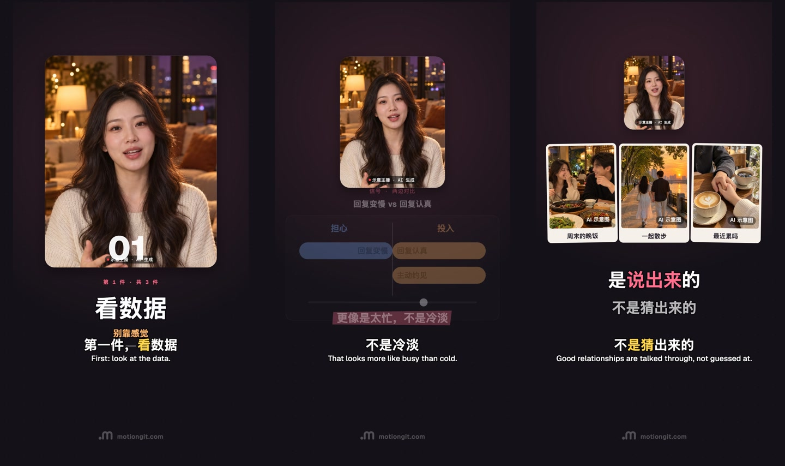

# Relationships · Reviewing a conversation

Observe patterns · Interpret signals · Ask clearly. Prelaunch portrait talking-head demo. Feedback welcome.

**9:16 · 1080 × 1920 · 60 fps · v1.0.2** · [@adunext](https://motiongit.com/@adunext) · [简体中文](README.zh-CN.md)

Motion templates now support asset APIs for background music, stickers, images and video, with free options. Upgraded templates remain **100% free and open source**. Download the upgrade from the official MotionGit page below. MotionGit links API access to individual accounts to prevent abuse from bulk requests. See MotionGit for the scope of free API usage.

**[Download .motion from MotionGit](https://motiongit.com/@adunext/industry-relationships-conversation-review)**
https://motiongit.com/@adunext/industry-relationships-conversation-review

Demo available. Check the official page for current download availability.

## Demo

[Full demo](https://motiongit.com/@adunext/industry-relationships-conversation-review) · [Play video](https://motiongit.com/media/previews/industry-v7/12m_love-demo-34d2434898ca0e2f.mp4)

## How it works

- Declared runtime profile: adudir.generator/1.
- Editable inputs are mapped through the template parameter schema and preset to its existing animation project.
- The declared duration policy follows the current voiceover; the package plan determines final timing rather than the demo length.

Demo duration: **98.08s**. The documented output is 1080 × 1920, 60 fps. The public demo is 98.08 seconds. Use the actual package parameter bounds; extra materials do not automatically create extra scenes.

## Inputs and materials

- **Required:** Your current talking-head video with its original audio for the native presenter workflow.
- **Optional:** Your photos and a title for this work.

Useful for: Observe patterns · Interpret signals · Ask clearly. Prelaunch portrait talking-head demo. Feedback welcome.

## Runtime requirements

- Declared runtime profile: adudir.generator/1. Check the downloaded package for exact tools and setup steps.
- Use the package dependency lock and setup/check instructions. Check existing tools first, install only missing requirements and verify a preview.

## Use the template

1. Obtain the current .motion package from the [template page](https://motiongit.com/@adunext/industry-relationships-conversation-review).
2. Extract or load it as documented, then read the included README and referenced production guide.
3. Use your own content and materials, reuse the working environment, and follow the package entry point to inspect a real preview.

You can give an assistant the repository URL and this request:

> https://github.com/motiontemplates/926144
>
> Use this .motion template with my content. Obtain the package from https://motiongit.com/@adunext/industry-relationships-conversation-review, extract or load it as documented, read the included README and referenced guide, reuse my working environment, and follow the package workflow to show an actual preview.

## .motion format

MotionGit .motion is a reusable video-template format that organizes the animation project, parameters, assets, dependencies and production guide. Its runtime uses new content to produce a finished video. [Format documentation](https://motiongit.com/spec)

[Versions, license & full download](https://motiongit.com/@adunext/industry-relationships-conversation-review) · [Production reference](ASSISTANT.md)
